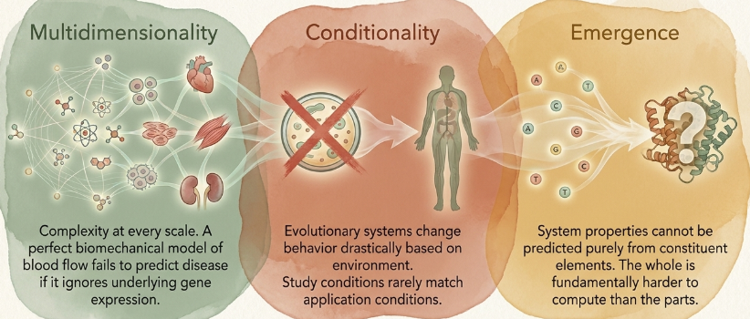
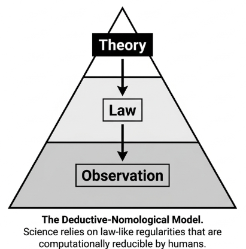
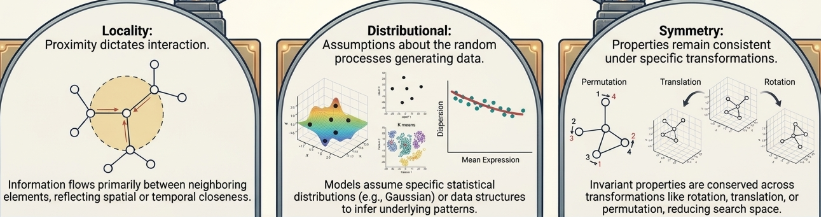
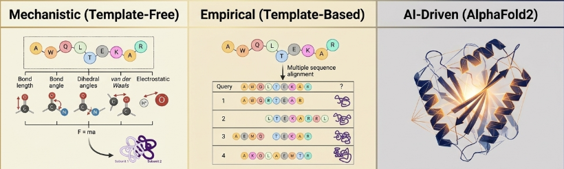
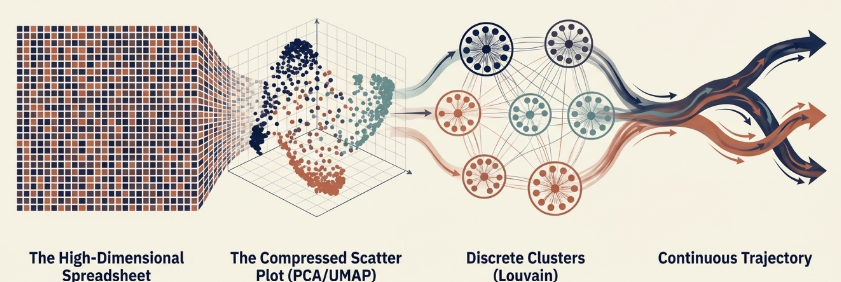

If you are introduced to complexity science, you would understand that complex concepts are not product driven but process-driven. It means without a particular avalanche of area the process covered, the result we might want is near impossible. The difference between physics and biological system is just like that. Physics equations are product based. Scientists found the underlying equation, made some true boundary conditions and that's that. It works simply and every single time with little to no error at all. However, the difference with that to a biological system is here. The variability is massive. If we dive deeper into the biological system, we will find complexity science as the core mechanism. 

When a doctor wanted to understand the cause of certain disease at the left knee, he/she must investigate the cause of that happening. The mechanical pressure, the neurological dysfunction, the hemodynamic property, the genetic mechanism, the immune reaction etc. The multidimensionality is so immense that, one human brain cannot process all of them together. That is why, a famous paper on BiorXiv talked about this specific thing how that powerful thought process of AI is integrated to the cause of biological system analysis. The paper [Understanding Biology in the Age of Artificial Intelligence](https://arxiv.org/abs/2403.04106) talked about the epistemology of understanding as we all know scientists want us to understand rather make AI to do all the work. The paper intensively reviewed how AI must be considered to offload some mental mechanics so that the working memory can be at a job of finding counterfactual arguments and qualitative assessment rather being stuck at infinity plus infinity in 3D. 

### Physics Has Simple Laws, But Biology is Computationally Irreducible

According to the theory of Computational Irreducibility by Stephan Wolfram, the biological system possess some core feature which makes it different from physics.

> Exception, Exception, Exception !!!!

- **Multidimensionality:** Biological systems operate across multiple intertwined scales of organization—from molecules and organelles to cells, tissues, and entire organisms. A biomechanical model of heart function might effectively describe blood flow dynamics, yet fail completely to predict heart disease because it cannot account for underlying shifts in cellular gene expression.
- **Conditionality:** Living systems radically alter their behavior based on their environment. For instance, the _in vitro_ bioactivity of a drug candidate in a petri dish routinely fails to extrapolate to _in vivo_ biological effects in animal models or human clinical trials.
- **Emergence:** Macro-properties emerge from biological systems that are virtually impossible to predict from constituent parts alone, such as predicting a protein's 3D shape solely from the individual chemical features of its amino acids.

As the living system is found by this features, the traditional deductive law is not enough to justify the behavior. The scientific progress in biology is mostly inductive reasoning. Machine learning, whose inductive nature is not a cheat code, rather an absolute necessity.

### You Don't Need an "Explanation" to Understand Something

For scientific understanding, it was a must for one to possess a deductive nomological explanation. But, modern epistemology has break that view into three distinct ideology. 

- Information Compress (Daniel Wilkenfeld): Wilkenfeld said that understanding is mostly encoding information and retrieve them when needed to specific target. Human brain does encode information in a certain way but falls short when encounters massive data surge. However, with the help of AI, now retaining target information is easier than ever.
- Qualitative Intelligibility (Henk De Regt): De Regt argues that scientific tools foster understanding when they allow scientists to make accurate qualitative predictions and reason about counterfactual scenario. Analytical tools in AI like dimensionality reduction using PCA or data visualization opens way for researchers to manipulate models, see patterns, catch mechanism and predict systems. 
- Dependency (Finnur Dellsén): Dellsén proposes that scientific understanding consists of capturing a phenomenon's network of dependencies. 

These frameworks fundamentally alter our view of artificial intelligence. We do not necessarily need fully transparent, fully explainable AI to gain real, methodologically sound scientific insight into complex biological phenomena.

### AI Architectures Work Because Humans Bake Their Own Intuition Into Them

Modern neural networks succeed because human hardcode their own scientific understanding of the system directly as a mathematical structure in Deep Learning architecture. These assumptions are called inductive biases. There are 3 primary classes of biases.
- Locality-related biases
- Distributional Biases
- Symmetry-Related Biases

Local pixels have the same characteristics of an image meaning using nose, eyes and muscle quenching in the face, a system can identify the pattern and closest match for any prediction. K-means clustering is the best example of locality-related biases. Local convolution process pixel in neighborhoods in medical imaging as an example. Graphical Neural Network enforce locality by executing message-passing operations strictly over local node neighborhoods in graph structured data. The distributional bias assume known probability distribution. This compresses data into fixed parameter. The DESeq2 model for RNA-sequencing relies on domain-specific dispersion assumptions to estimate uncertainty robustly. Lastly, symmetry biases is basically geometrical deep learning. GNNs use **permutation symmetry** so that reordering graph nodes does not alter predictions, while geometric models enforce 3D **rotational** and **translational symmetries** for molecular coordinates.

By baking human intuition into the model's structural geometry, researchers reduce the dimensionality of the learning task, giving machine learning systems robust mathematical guardrails.

### AlphaFold2 and Protein Folding 

A physics based model of protein folding fails at the edge of 50 amino acids because calculating protein interactions means heavy computational power. AlphaFold2 does this with mechanistical advantage with empirical evidence, predicting thousands of 3D structures in one. 

AlphaFold2 has two structural design innovations. **The Evoformer** It takes a multiple sequence alignment (MSA) and figures out which positions in a protein influence one another. Row-wise attention lets residues in the same sequence swap information. Column-wise attention looks at one position across related sequences, and that's where covariation shows up. Triangular update and triangular attention layers sit on top. They borrow the triangle inequality from Euclidean geometry, so the residue-pair representations don't drift away from believable physical distances. **The Structure Module** Every residue gets its own 3D frame. A rotation captures the backbone's orientation, and a translation marks where the alpha carbon sits. Invariant Point Attention (IPA) scores how residues relate, and those scores stay the same if you spin or shift the entire protein as a rigid body. This puts symmetry and locality into the design. AlphaFold2 does more than memorize its training data; it exhibits broad biochemical reasoning.

### Static Cell into Dynamic Tissue 

Simpson's paradox is why bulk averaging misleads. Pool the data from a whole population of cells, and a real pattern can vanish, or even flip, inside a small subgroup. Think of cells passing through a brief stage of the cell cycle, or a rare line of stem cells. Single-cell RNA sequencing (scRNA-seq) fixes that by reading each cell's transcriptome across thousands of genes. But it only gives you a frozen moment, because measuring a cell destroys it.

Machine learning gets around this in three steps.

1. **Dimensionality reduction.​** The data starts with thousands of dimensions, and it gets squeezed down to a 2D or 3D picture. PCA does this in a straight-line way. t-SNE and UMAP go further. They build neighbor graphs on the assumption that cells close together are alike. Single-cell data is full of zeros ("dropout events"), and ZIFA (Zero-Inflated Factor Analysis) is built for that. It assumes a specific statistical pattern for those zeros.
2. **Clustering and annotation.​** Louvain and Leiden scan a graph of cell similarities and sort cells into functional groups. Researchers then match those groups against known marker genes, so the picture makes sense to a person.
3. **Trajectory inference.​** Cells are lined up along a continuous path of development, based on how similar their transcription is. This rebuilds processes such as B cell development, neurogenesis, and blood cell differentiation. No time-series data is needed.

### Conclusion

Biology is now a data-driven science, and that changes how research gets done. Living systems have many layers. They react to their surroundings, and you can't skip ahead to their outcomes. So the neat deductive laws that worked so well in classical physics don't fit them. That doesn't mean rigor is lost. AI offers a new way to do discovery. It boils huge datasets down to their core patterns (Wilkenfeld). It gives researchers a feel for what will happen, even without exact math (De Regt). It also maps how the parts of a system depend on each other (Dellsén). Together, these let machine learning models give real understanding of living systems. As neural networks get more capable, experts aren't being pushed out. Their knowledge is being built into how the models are designed, through inductive biases.

### Sources
[Understanding Biology in the Age of Artificial Intelligence](https://arxiv.org/abs/2403.04106)
