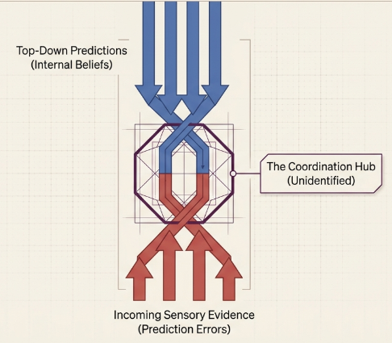
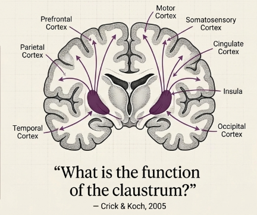
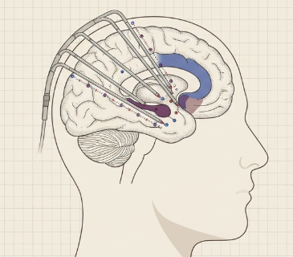
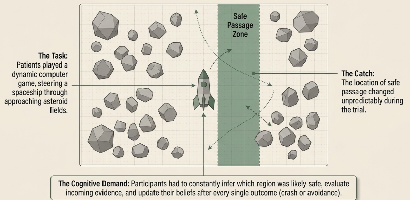
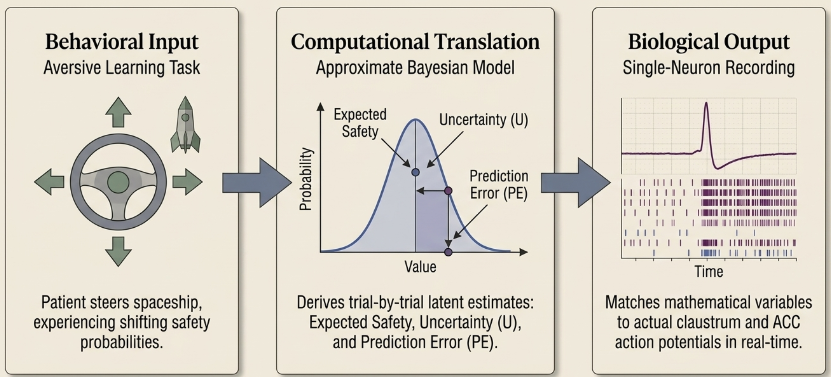
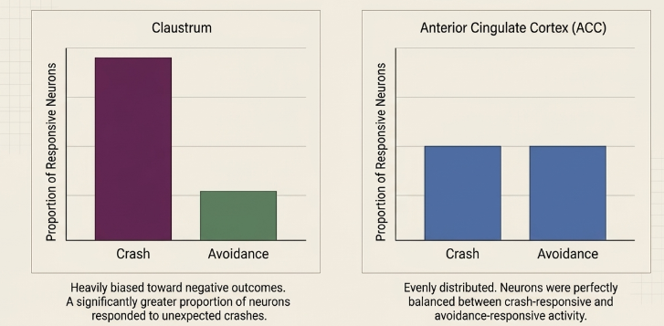

Our brain continuously searches for answers. Answers for the immediate next step, next word, next thoughts, next event etc. In this ever changing environment, human brain calculates uncertainty, tracks prediction error when there is a surprised outcome occurs. A well-know study published in _Nature Neuroscience_ by Mingyue Hu and Eyiyemisi C. Damisah from Yale University, titled **"[Human Claustrum Neurons Encode Uncertainty and Prediction Errors during Aversive Learning](https://www.nature.com/articles/s41593-026-02475-x)"** debunked the myths of how a single neuron to a bunch of neuron fiber in the specific brain region deals with rapid brain error and updating system. The study offers direct electrophysiological evidence. It founds that claustrum is the region where the computation of belief updating occurs rapidly when a surprise advances from prior to posterior. 

Claustrum is a region situated in deep within the white matter of each cerebral hemisphere. This region is virtually connected to the cerebral cortex and subcortical areas in brain. Before this research, little that the society knew about what claustrum does in active cognition mode? The primary research question was: *Do individual neurons in the human claustrum track internal mathematical variables, specifically uncertainty and prediction error, as beliefs are updated during learning?* 

To understand that, they researched on 7 patient recently gone through a brain surgery to monitor drug resistant epilepsy. While monitoring, they evaluated specifically claustrum to check how they react to uncertain condition and a crash using an Asteroid game.

#### The Behavioural Game
Participants steered a virtual spaceship through approaching asteroid fields, where the location of a safe passage changed unpredictably. Participants had to continually infer which corridor was safe and update their beliefs after every trial:

- **Avoidance (Positive Outcome):** Successfully navigating through the safe gap.
- **Crash (Negative/Aversive Outcome):** Colliding with an asteroid.

#### The Computational Bayesian Model
Following a computation framework for aversive learning established by Wise and Dolan, alongside precision-weighted Bayesian inference principles reviewed by Yon and Frith, the researchers fitted participants' choice behaviour with an approximate Bayesian learning model. This model derived trial-by-trial estimates for three latent variables. The variables are expected safety, uncertainty and prediction error. 

#### Discovery 
While the participants performed the task, their single neuron action potential were recorded. To compare with claustrum, other regions like ACC (anterior cingulate cortex), amygdala and insula were also taken into account. The study showed that claustrum single handedly dealt with almost all the active tracking of internal belief system derived from the internal computational model. Around 70% of the neurons in claustrum and ACC faced firing events when the two most vital events occur in the game. The asteroid appearance and the outcome resolution. However, they also differentiate between the claustrum and ACC. Claustrum mostly did the close loop feedback part whereas ACC is mostly the reaction and motor alert system. Before the arrival of the asteroid in the screen, ACC fired which indicates that the ACC is mostly **pre-stimulus belief association** system. And claustrum is mostly the **post-stimulus belief correction** system.

There were biases along the outcomes. The claustrum neurons mostly reacted to outcome, meaning crashes than to avoidance. However, 32 claustrum neurons tracked trial by trial uncertainty and 25 claustrum neuron tracked prediction errors. Firing rate peaked when crashes occurred which is high uncertainty and large prediction error AKA surprise. 

#### Limitations
However, the number of patients were only 7 who are deeply associated with medicines and the condition of the test was clinical environment. Also, the electrode arrays only covered sub regions of claustrum, not the entire claustrum. Uncertainty and prediction error were correlated in this task, limiting their complete mathematical separation at the single-neuron level.

To build on these findings, future studies aim to pair larger multi region human recordings with causal perturbations (such as micro stimulation) to test whether altering claustrum firing directly alters belief updating, while exploring non-aversive task contexts.

#### Sources
[Human claustrum neurons encode uncertainty and prediction errors during aversive learning](https://www.nature.com/articles/s41593-026-02475-x)
